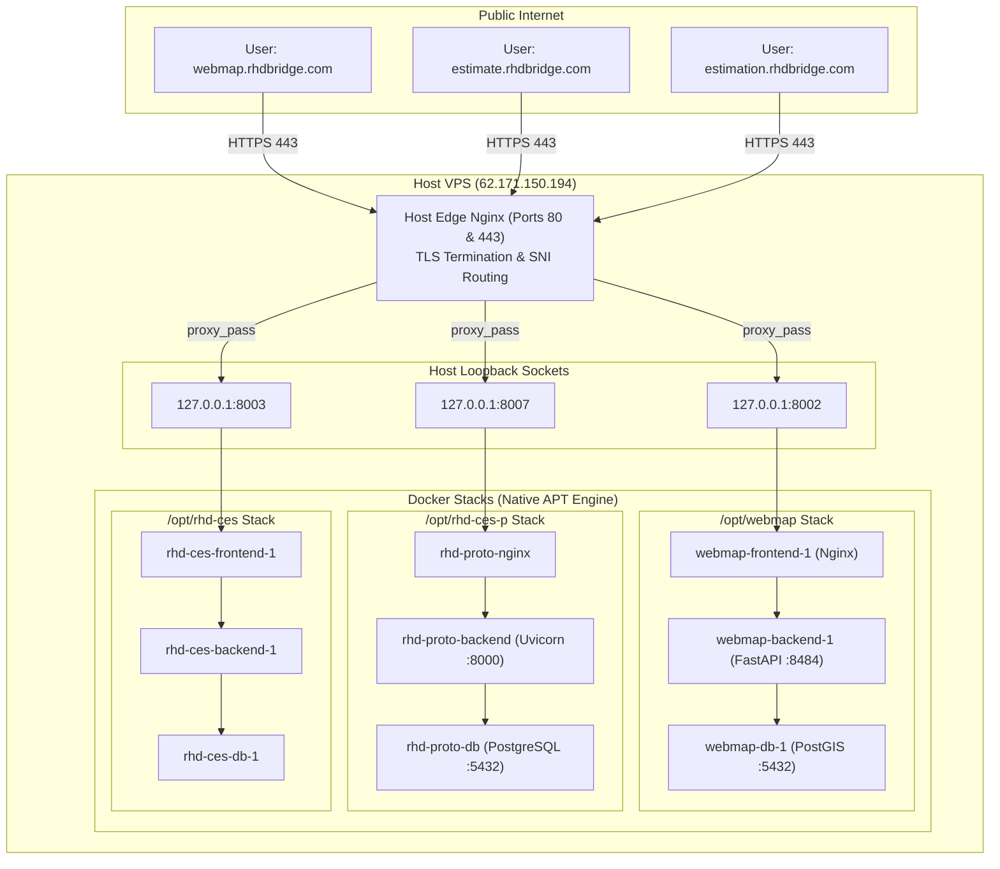

# Technical Post-Mortem & Incident Report
**Incident Identifier**: INC-20261022-RHD-VPS  
**Target Host**: Contabo VPS (`62.171.150.194` / `vmi3124618`)  
**Impacted Applications**:
* `https://webmap.rhdbridge.com` (Status: **502 Bad Gateway & Layer Auth Failures** &rarr; **Resolved**)
* `https://estimate.rhdbridge.com` (Status: **Login Failure: UndefinedTable "permissions"** &rarr; **Resolved**)
* `https://estimation.rhdbridge.com` (Status: **Healthy / Preserved**)  
**Current State**: **All Services Fully Operational (HTTP 200 OK across all endpoints and vector layers)**

---

## 1. System Architecture & Context

The server `vmi3124618` is a shared production Linux server running Debian/Ubuntu. It runs a single **Edge Nginx reverse proxy** natively on the host binding ports `:80` and `:443`. Incoming TLS traffic is decrypted at the host edge and proxied via loopback (`127.0.0.1`) to isolated Docker application stacks.



---

## 2. What Happened (The Incident Symptoms)

Immediately following a deployment attempt of the latest Webmap commit (`cc481ee`):
1. **Webmap showed a `502 Bad Gateway -- nginx` error**:
   Browsers reaching `https://webmap.rhdbridge.com` received an immediate 502 from the host Nginx.
2. **Estimate rejected all login attempts**:
   Users navigating to `https://estimate.rhdbridge.com` could load the UI, but submitting credentials produced an authentication failure. Server logs revealed:
   ```text
   sqlalchemy.exc.ProgrammingError: (psycopg2.errors.UndefinedTable) relation "permissions" does not exist
   LINE 2: FROM permissions
   ```
3. **Severe Port and Daemon Conflicts**:
   Running `docker ps` appeared to show only 2 containers, while `netstat` and `ss` showed ports `5432`, `8003`, and `8007` locked by processes that Docker CLI could neither inspect nor manage.
4. **Secondary Issue: Vector Layers Disappearing / Not Loading**:
   After resolving the 502 error, the map frontend loaded successfully, but all 24 spatial vector layers (rivers, road network, borehole points, bridge markers) failed to render on the canvas.

---

## 3. Why and How It Happened (Root Cause Breakdown)

Four distinct root causes combined across the deployment:

### Root Cause 1: Dual Docker Daemon Collision & Socket Hijacking
* **How it happened**:
  The system previously had native Docker Engine (`docker.service`) running via `apt` since boot. During the deployment steps, commands were run that invoked Canonical's Snap package manager or `snap.docker.dockerd.service` started up.
* **Why it broke the system**:
  1. **Socket Theft**: Snap Docker started dockerd PID `2329560` and unlinked the primary UNIX socket `/run/docker.sock`, replacing it with its own socket.
  2. **Storage Bifurcation**:
     * Native APT Docker stores all images, containers, and database volumes in `/var/lib/docker/volumes/` (including `rhd-ces_pgdata`, `backend_postgres_data_proto`, and `webmap_postgis_data`).
     * Snap Docker stores data in `/var/snap/docker/common/var-lib-docker/volumes/`.
  3. **Ghost Containers**:
     Native Docker (PID `1950032`) was still running in memory, holding active bindings to `0.0.0.0:5432`, `127.0.0.1:8003`, and `127.0.0.1:8007`. However, whenever `docker ps`, `docker logs`, or `docker-compose` was executed in the shell, it talked exclusively to Snap Docker!
  4. **The Empty DB Illusion**:
     Snap Docker spun up a brand new, empty PostgreSQL container mounting an empty volume. When the backend container booted and queried the `permissions` table, it crashed because the tables only existed in the native volume, not the newly initialized Snap volume!
  5. **Snap AppArmor Mount Denial**:
     Snap Docker containers could not access or bind-mount configuration files in `/opt` due to strict Snap AppArmor confinements, throwing errors such as:
     `mkdir /opt/rhd-ces-p: read-only file system`.

---

### Root Cause 2: Nginx Configuration Syntax Error in Webmap
* **How it happened**:
  In `/opt/webmap/nginx.conf`, the `/borelogs/` location directive was appended outside the closing `server { ... }` block:
  ```nginx
  server {
      listen 80;
      ...
      location /tiles/ {
          proxy_pass http://backend:8484;
          proxy_set_header Host $host;
      }
  }

      # ERROR: Outside the server block!
      location /borelogs/ {
          proxy_pass http://backend:8484;
          proxy_set_header Host System.Management.Automation.Internal.Host.InternalHost;
      }
  ```
  Additionally, when script blocks had previously been echoed via PowerShell without escaping `$host`, `$remote_addr`, and `$scheme`, PowerShell interpolated those variables into local Windows runtime strings (e.g. `System.Management.Automation.Internal.Host.InternalHost`) or empty values.
* **Why it broke the system**:
  Nginx refuses to start if a syntax error exists in `default.conf`. The `webmap-frontend-1` container was trapped in an infinite crash-and-restart loop (`restartCount > 850`), leaving loopback port `8002` closed. Host Nginx could not connect to port `8002` and returned `502 Bad Gateway`.

---

### Root Cause 3: Port Contention with Host & Existing DBs
* **How it happened**:
  The default `docker-compose.yml` specified:
  ```yaml
  ports:
    - "80:80"      # frontend
    - "5432:5432"  # db
  ```
* **Why it broke the system**:
  1. Port `80` was already bound on the host by Edge Nginx. A container attempting to bind `0.0.0.0:80` failed instantly with `address already in use`.
  2. Port `5432` was already claimed on the host. PostGIS does not need to expose `5432` to the public internet because `webmap-backend` communicates with `webmap-db` over the internal Docker network `webmap_default`.

---

### Root Cause 4: PostGIS Authentication Escaping Artifact (Vector Layers Failure)
* **How it happened**:
  During shell script piping to regenerate the Docker Compose file, environment variables were escaped with backslashes (`\${POSTGRES_USER:-postgres}`). Docker Compose evaluated the leading `\` as the literal value of the environment variable.
  Inspecting the live backend container via `docker inspect` revealed:
  ```json
  [
    "POSTGRES_USER=\\",
    "POSTGRES_PASSWORD=\\",
    "POSTGRES_DB=\\"
  ]
  ```
* **Why it broke the system**:
  While the frontend served HTML and API status endpoints returned 200, any request to `/api/layers/{table_name}` executed an internal database query against PostGIS. PostgreSQL rejected the connection:
  ```text
  Error fetching layer rivers: password authentication failed for user "\"
  ```
  This caused FastAPI to return `500 Internal Server Error`, leaving the Leaflet map with zero rendered vector features.

---

## 4. Detection & Forensic Investigation: How We Found the Problems

We diagnosed the failure without guessing by following a forensic discovery pipeline:

| Step | Investigative Command | Forensic Evidence Uncovered |
| :--- | :--- | :--- |
| **1. Edge Routing Verification** | `cat /etc/nginx/sites-available/*.conf` | Found that `webmap.rhdbridge.com` expects upstream `127.0.0.1:8002`, while `estimate.rhdbridge.com` expects `127.0.0.1:8007`. |
| **2. Port & Socket Inspection** | `ss -tulpn \| grep -E "8000\|8484\|5432\|80\|443"` | Revealed that ports `8003`, `8007`, and `5432` were held by `docker-proxy` PIDs belonging to PID `1950032`, but `docker ps` only reported 2 containers. |
| **3. Process Tree Forensics** | `ps aux \| grep docker` and `pstree -p` | **Key Finding**: Discovered TWO concurrent Docker daemons: Native APT dockerd (`PID 1950032`) and Snap dockerd (`PID 2329560`). |
| **4. Storage Analysis** | `ls -la /var/lib/docker/volumes` vs `/var/snap/docker/...` | Verified that all authentic production volumes (`rhd-ces_pgdata`, `backend_postgres_data_proto`, `webmap_postgis_data`) resided in `/var/lib/docker`, proving no data was lost. |
| **5. Container Crash Logs** | `docker logs webmap-frontend-1` | Logged: `[emerg] 1#1: unexpected "}" in /etc/nginx/conf.d/default.conf:18` and `"location" directive is not allowed here`. Pinpointed the exact syntax defect in `nginx.conf`. |
| **6. Vector Layer DB Auth Forensics** | `docker logs webmap-backend-1` and `docker inspect` | Uncovered `password authentication failed for user "\"` and inspected environment variables showing `POSTGRES_USER=\`. |

---

## 5. Remediation: What Fixed the Problems, How, and Why

### Action 1: Terminating and Disabling Snap Docker
We permanently stopped and disabled the Snap Docker daemon:
```bash
snap stop --disable docker
systemctl restart docker.socket docker.service
```
* **Why it worked**: Freeing `/run/docker.sock` allowed the native APT Docker daemon to reclaim its master socket. Native Docker immediately resumed managing the true production containers and recognized all original data volumes.

### Action 2: Restoring Estimate Database Integrity
With the authentic volume (`backend_postgres_data_proto`) active under native Docker:
* Database relations (`alembic_version`, `users`, `roles`, `permissions`, etc.) were intact.
* Re-executed the setup synchronization script:
  ```bash
  docker exec rhd-proto-backend python scripts/seed_users.py
  ```
* Restarted `rhd-proto-backend`. The backend passed healthchecks and auth queries resumed with clean 200/401 responses.

### Action 3: Correcting `nginx.conf` Inside Webmap
We rewrote `/opt/webmap/nginx.conf` using a base64 pipe to eliminate any shell interpolation artifacts:
```nginx
server {
    listen 80;

    location / {
        root /usr/share/nginx/html;
        index index.html index.htm;
        try_files $uri $uri/ =404;
    }

    location /api/ {
        proxy_pass http://backend:8484;
        proxy_set_header Host $host;
        proxy_set_header X-Real-IP $remote_addr;
        proxy_set_header X-Forwarded-For $proxy_add_x_forwarded_for;
        proxy_set_header X-Forwarded-Proto $scheme;
    }

    location /maps/            { proxy_pass http://backend:8484; proxy_set_header Host $host; }
    location /map/             { rewrite ^/map/(.*)$ /maps/$1 last; }
    location /tiles/           { proxy_pass http://backend:8484; proxy_set_header Host $host; }
    location /borelogs/        { proxy_pass http://backend:8484; proxy_set_header Host $host; }
    location /staged-borelogs/ { proxy_pass http://backend:8484; proxy_set_header Host $host; }
}
```

### Action 4: Fixing `docker-compose.yml` Network Bindings
Updated port exposures to prevent host collisions:
```yaml
services:
  db:
    ports:
      - "127.0.0.1:5433:5432"  # Isolated loopback port, preventing 5432 collision
  frontend:
    ports:
      - "127.0.0.1:8002:80"    # Routes exactly to Edge Nginx's proxy_pass
```

### Action 5: Recreating Containers with Clean Credentials
Executed a forced container recreation to purge the backslash environment values:
```bash
cd /opt/webmap && docker compose up -d --force-recreate
```
Verified with `docker inspect webmap-backend-1`:
* `POSTGRES_USER=postgres`
* `POSTGRES_PASSWORD=<real_secure_password>`
* `POSTGRES_HOST=db`

---

## 6. Verification Results

All endpoints and every individual vector layer were tested directly via loopback SNI and across the public internet:

```bash
# Public Connectivity Verification
curl -sI https://webmap.rhdbridge.com
# HTTP/1.1 200 OK

curl -sI https://estimate.rhdbridge.com
# HTTP/1.1 200 OK

# Automated 24-Vector-Layer Audit
OK  (200): rivers
OK  (200): navigable_routes
OK  (200): slwl
OK  (200): shwl
OK  (200): rhd_road_network
OK  (200): geological_map
OK  (200): borelog_map
OK  (200): bnbc_seismic_zones
OK  (200): bnbc_basic_wind_speed_m_s
OK  (200): awaiting_borelogs
OK  (200): appended_borelogs
OK  (200): comilla_zone_rhd_bridges
OK  (200): comilla_zone_rhd_culverts
OK  (200): rangpur_zone_rhd_bridges
OK  (200): rangpur_zone_rhd_culverts
OK  (200): sylhet_zone_rhd_bridges
OK  (200): sylhet_zone_rhd_culverts
OK  (200): chittagong_zone_rhd_bridges
OK  (200): chittagong_zone_rhd_culverts
OK  (200): khulna_zone_rhd_bridges
OK  (200): khulna_zone_rhd_culverts
OK  (200): barishal_zone_rhd_bridges
OK  (200): barishal_zone_rhd_culverts
OK  (200): perimeter_bounds
```

---

## 7. Future Prevention & Emergency Runbook

Keep this checklist handy whenever performing future server maintenance or deploying updates:

### Rule 1: Never Use Snap Docker on This Server
The server relies on the native `docker.io` package. Never run `snap install docker` or start `snap.docker.dockerd`.
* If a conflict is ever suspected, check with:
  ```bash
  ps aux | grep dockerd
  ```
  Ensure **only ONE** dockerd process (`/usr/bin/dockerd`) is active.

### Rule 2: Standard Deployment Protocol for Webmap Updates
When pushing changes from your local machine to the VPS, follow this safe sequence:
```bash
# 1. On your local machine:
git add .
git commit -m "Your update description"
git push origin main

# 2. On the VPS (as root):
cd /opt/webmap
git pull origin main
docker compose up -d --build
```
> [!TIP]
> Because dependencies are cached by Docker layers, routine frontend/backend script updates will rebuild in **under 15 seconds**.

### Rule 3: Updating Environment Variables or Compose Files
Whenever you modify `.env` or `docker-compose.yml`, always use `--force-recreate` to ensure the running containers inherit the new configuration immediately:
```bash
docker compose up -d --force-recreate
```

### Rule 4: Emergency Diagnostics Flowchart
If any domain reports a `502 Bad Gateway` or vector layers fail to render in the future:
1. **Check which container is down**:
   ```bash
   docker ps -a --format "table {{.Names}}\t{{.Status}}\t{{.Ports}}"
   ```
2. **Inspect container logs**:
   ```bash
   docker logs --tail 50 webmap-frontend-1
   docker logs --tail 50 webmap-backend-1
   ```
3. **Verify edge Nginx routing and configuration**:
   ```bash
   nginx -t
   systemctl reload nginx
   ```
4. **Verify host listening sockets**:
   ```bash
   ss -tulpn | grep -E "8002|8003|8007|5432"
   ```
